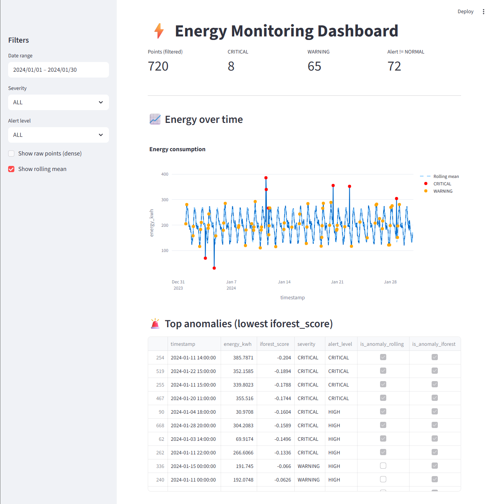

# ⚡ Energy Monitoring Platform

An end-to-end energy anomaly detection system combining statistical methods and machine learning, with an interactive dashboard.

## 📊 Dashboard Preview


---

## 🚀 Project Overview

This project detects abnormal energy consumption patterns using:

- Rolling statistical baseline detection
- Isolation Forest (unsupervised ML)
- Severity classification logic
- Interactive Streamlit dashboard

The system is designed to simulate a real-world monitoring tool used in industrial or building energy management contexts.

---

## 🧠 Detection Logic

### 1️⃣ Rolling Detection
Seasonal rolling baseline (24h window) with dynamic standard deviation threshold.

### 2️⃣ Isolation Forest
Unsupervised anomaly detection using:
- `energy_kwh`
- `hour of day`

Produces a continuous anomaly score.

### 3️⃣ Severity Classification

| Rolling | Isolation Forest | Result |
|----------|------------------|--------|
| False | False | NORMAL |
| True | False | WARNING |
| False | True | WARNING |
| True | True | CRITICAL |

### 4️⃣ Alert Level
Severity is mapped to operational alert levels:
- NORMAL
- MEDIUM
- HIGH
- CRITICAL

---

## 📊 Dashboard

Built with Streamlit + Plotly:

- Interactive time series
- Rolling mean overlay
- Anomaly highlighting
- Severity filtering
- Alert level filtering

Run locally:

```bash
streamlit run streamlit_app.py